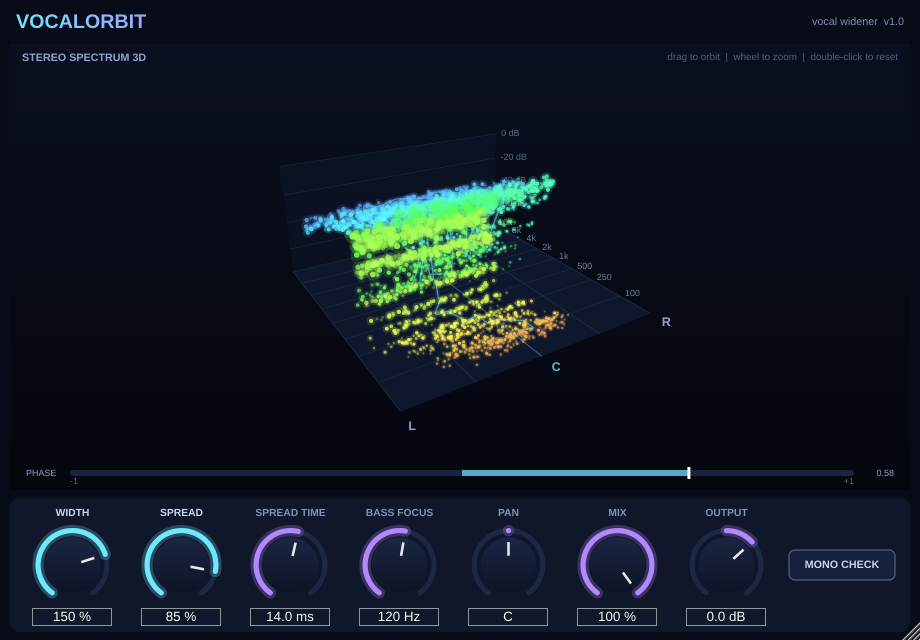

# VocalOrbit — vocal widener with a 3D stereo spectrum

A VST3 plugin (works in FL Studio, Ableton, Reaper, Studio One, etc.) that widens
vocals and shows them in a rotating 3D view, with glowing dots marking where each
frequency sits in the stereo field.



## What it does

| Control | What it does |
|---|---|
| **WIDTH** (0–200%) | Scales the existing stereo (side) content. 100% = unchanged, 0% = mono, 200% = extra wide. |
| **SPREAD** (0–100%) | Creates width from a **mono** vocal. Width alone can't widen a mono recording (it has no side signal); Spread adds a delayed copy as side signal, so L = M + D and R = M − D. It **cancels perfectly in mono**, so the vocal never disappears on phone speakers or club systems. |
| **SPREAD TIME** (2–35 ms) | Delay used by Spread. 8–18 ms suits most vocals; shorter sounds tighter and longer sounds roomier. |
| **BASS FOCUS** (20–500 Hz) | High-passes the stereo part only, so the low end stays centred and punchy. |
| **PAN** | Balance control. |
| **MIX** | Dry/wet. |
| **OUTPUT** | Output gain (−24 to +12 dB). |
| **MONO CHECK** | Sums the output to mono so you can check that the vocal still holds up. |

### The 3D view
- **Left ↔ Right** = stereo position
- **Front → Back** = frequency (100 Hz at the front, 16 kHz at the back)
- **Height** = loudness (dB)
- **Dots** = sound energy. Each frequency band spawns dots where its energy is. Mono sound
  forms a thin line down the centre (C); wide sound scatters into a cloud left and right.
  Colour goes from warm (lows) to cool (highs).
- **Cyan line** = the "centre of gravity" of each frequency band.
- **PHASE meter** = L/R correlation. +1 = mono, 0 = very wide, and **red (below 0) = phase
  problems**, so back off Width/Spread.
- Drag to orbit, use the mouse wheel to zoom, and double-click to reset the camera.

Quick vocal starting point: Width 100%, Spread 30–50%, Spread Time 12 ms, Bass Focus 150 Hz.

---

## Getting a Windows .vst3 (easiest: no compiler needed)

1. Create a free GitHub account and a new repository, then upload this whole folder (including the
   hidden `.github` folder).
2. Open the **Actions** tab. The "Build VST3" workflow runs automatically (about 10 minutes).
3. Open the finished run and download **VocalOrbit-Windows-VST3** from *Artifacts*.
4. Unzip it and copy the `VocalOrbit.vst3` folder to
   `C:\Program Files\Common Files\VST3\`.

## Building on your own Windows PC

1. Install **Visual Studio 2022 Community** with the *"Desktop development with C++"* workload
   (this includes CMake). Also install **Git**.
2. Open *"Developer PowerShell for VS 2022"* in this folder and run:
   ```
   cmake -B build -G "Visual Studio 17 2022"
   cmake --build build --config Release --target VocalOrbit_VST3
   ```
   The first configure downloads JUCE automatically.
3. The plugin is at `build\VocalOrbit_artefacts\Release\VST3\VocalOrbit.vst3`. Copy it to
   `C:\Program Files\Common Files\VST3\`.

(A standalone app target `VocalOrbit_Standalone` also exists for testing without a DAW.)

## Loading it in FL Studio

1. **Options → Manage plugins → Find more plugins** (or *Start scan*). Make sure
   `C:\Program Files\Common Files\VST3` is in the search paths.
2. Once it's found, star/tick **VocalOrbit** so it shows up in your effects list.
3. On your vocal's Mixer insert, click an empty slot → **VocalOrbit**.

## Project layout

```
Source/
  PluginProcessor.*   audio DSP (width, spread, bass focus, pan, mix, gain)
  PluginEditor.*      UI layout, knobs, custom look
  Scene3D.*           FFT analysis + 3D stereo spectrum with dots
  StereoSampleFifo.h  lock-free audio -> UI sample queue
test/RenderTest.cpp   offline test that renders screenshots (optional)
.github/workflows/    automatic Windows + macOS builds
```

## Ideas for next versions
- Presets (Subtle / Pop Lead / Huge Chorus / Ad-libs)
- A slow modulation on Spread Time for a chorus/doubler effect
- OpenGL rendering for even smoother visuals at large window sizes
- A "before vs after" toggle that shows the input cloud next to the output
