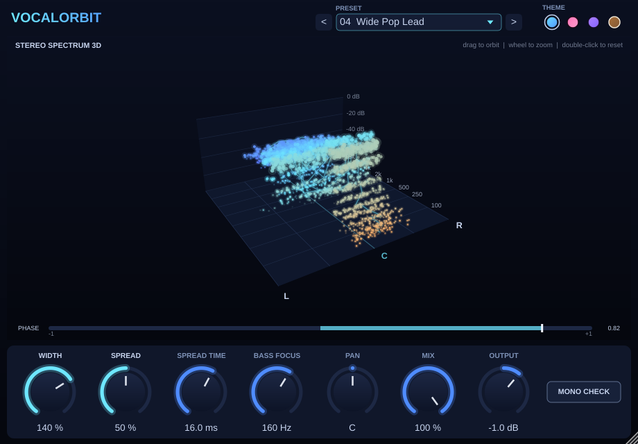
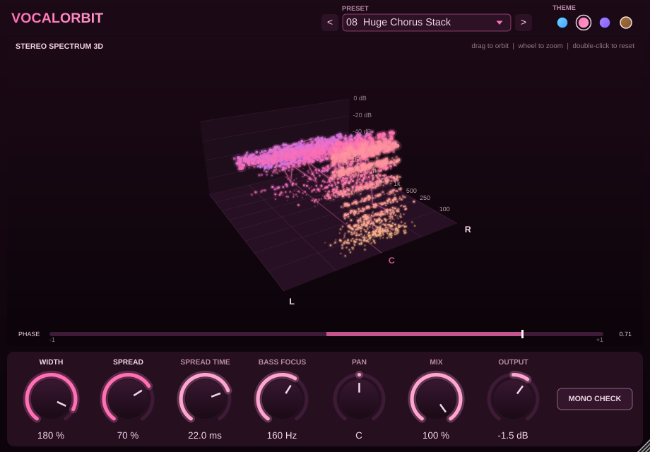
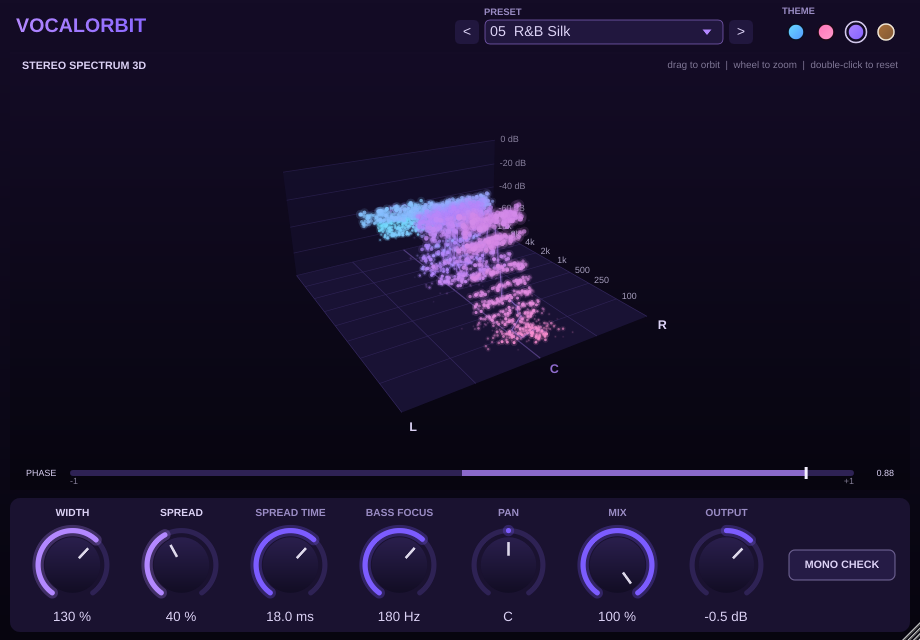
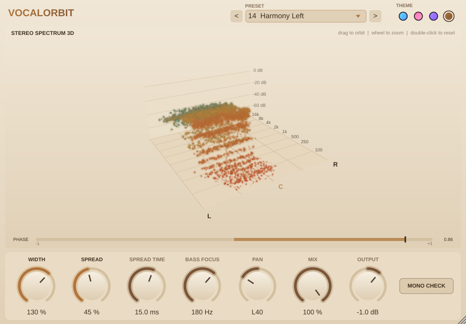
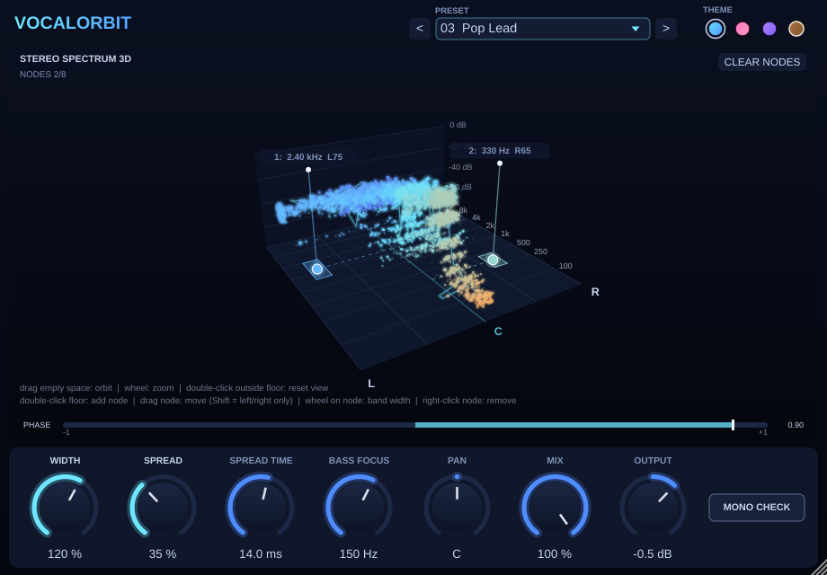
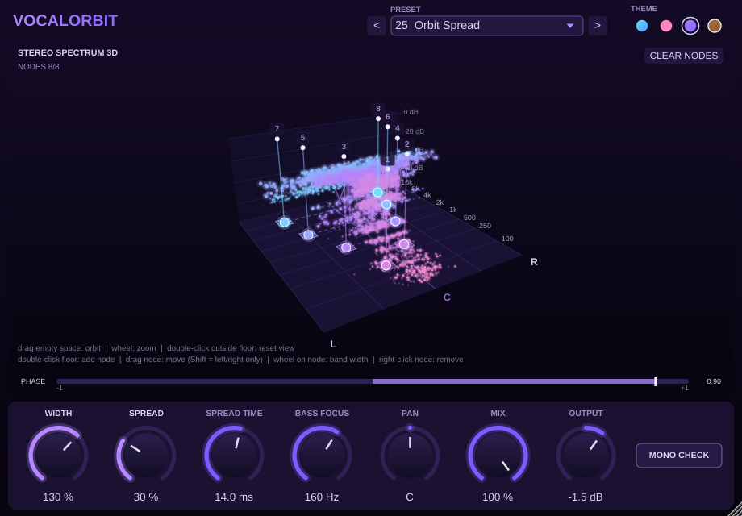

# VocalOrbit — vocal widener with a 3D stereo spectrum

A VST3 plugin (works in FL Studio, Ableton, Reaper, Studio One, etc.) that widens
vocals and shows them in a rotating 3D view, with glowing dots marking where each
frequency sits in the stereo field.

| Blue | Pink |
|---|---|
|  |  |
| **Purple** | **Tan** |
|  |  |

## What it does

| Control | What it does |
|---|---|
| **WIDTH** (0–200%) | Scales the existing stereo (side) content. 100% = unchanged, 0% = mono, 200% = extra wide. |
| **SPREAD** (0–100%) | Creates width from a **mono** vocal. Width alone can't widen a mono recording (it has no side signal); Spread adds a delayed copy as side signal, so L = M + D and R = M − D. It **cancels perfectly in mono**, so the vocal never disappears on phone speakers or club systems. |
| **SPREAD TIME** (2–35 ms) | Delay used by Spread. 8–18 ms suits most vocals; shorter sounds tighter and longer sounds roomier. |
| **BASS FOCUS** (20–500 Hz) | High-passes the stereo part only, so the low end stays centred and punchy. |
| **PAN** | Balance control. |
| **MIX** | Dry/wet. |
| **OUTPUT** | Output gain (−24 to +12 dB). |
| **MONO CHECK** | Sums the output to mono so you can check that the vocal still holds up. |

### Frequency nodes: place any frequency anywhere


Pick a range of frequencies in the 3D view and move it to wherever you want in the stereo field.
For example, push the airy 8–12 kHz range to the left, or the body of the voice (around 300 Hz)
slightly right.

| Do this | What happens |
|---|---|
| **Double-click the floor** | Adds a node there, grabbing the frequencies at that spot |
| **Drag a node** | Moves it: left/right = stereo position, front/back = which frequencies |
| **Shift + drag** | Moves left/right only (keeps the same frequency) |
| **Mouse wheel on a node** | Makes the grabbed frequency range wider or narrower (0.2 to 3 octaves) |
| **Right-click a node** | Removes it |
| **CLEAR NODES** | Removes all nodes |

- You get up to **8 nodes**. Each node's on/off, frequency, position and band width are normal plugin parameters,
  so FL Studio saves them with the project and you can **automate** them (e.g. sweep a band from left to right).
- The shaded strip on the floor shows the range of frequencies the node grabs. The dashed line shows how
  far it has been moved from the centre.
- A node left in the centre doesn't change the sound at all. Only moving it changes anything.

### Themes
Click one of the four colour dots (top right) to switch the theme: **Blue, Pink, Purple or Tan**.
Your choice is saved with your FL Studio project.

### Presets (25)
Use the preset menu or the `<` `>` arrows at the top. The presets also show up in FL Studio's own preset menu.

| # | Preset | Use it for |
|---|---|---|
| 1 | Init | Neutral starting point |
| 2 | Subtle Lead | A touch of air on a lead vocal |
| 3 | Pop Lead | Polished, slightly wide lead |
| 4 | Wide Pop Lead | Big modern pop lead |
| 5 | R&B Silk | Smooth, wide and soft |
| 6 | Rap Upfront | Punchy and centred, just a little width |
| 7 | Trap Ad-libs | Very wide ad-libs around the lead |
| 8 | Huge Chorus Stack | Wall-of-vocals chorus |
| 9 | Backing Vocals Wide | Push backing vocals out to the sides |
| 10 | Tight Doubler | Fake double-tracking |
| 11 | Ambient Haze | Dreamy, spacious vocals |
| 12 | Lo-Fi Narrow | Narrow, vintage feel |
| 13 | Mono Focus | Collapse to mono |
| 14 | Harmony Left | Harmony placed left |
| 15 | Harmony Right | Harmony placed right |

**Frequency placement presets.** These use the movable nodes. Load one, then drag the nodes to fine-tune it.

| # | Preset | Where the frequencies go |
|---|---|---|
| 16 | Air Split | 9 kHz air to the left, 13.5 kHz to the right |
| 17 | Body Right Air Left | Body (300 Hz) slightly right, air (9.5 kHz) left |
| 18 | Sibilance Spread | "S" sounds split left/right so they don't stab the centre |
| 19 | Presence Swirl | 2 / 3.2 / 5 kHz alternate L-R-L |
| 20 | Wide Harmonics | Four mid harmonic ranges alternating L/R |
| 21 | Breathy Halo | Breath and air pushed wide on both sides |
| 22 | Dark Left Bright Right | Lows to the left, highs to the right |
| 23 | Stereo Telephone | Low-mids hard left, upper mids hard right, for an effect |
| 24 | Ad-lib Scatter | Four ranges thrown wide for ad-libs |
| 25 | Orbit Spread | All 8 nodes, from 180 Hz to 12 kHz, swinging out wider as they go up |



Loading presets 1–15 removes any nodes, so they always sound the same.

### The 3D view
- **Left ↔ Right** = stereo position
- **Front → Back** = frequency (100 Hz at the front, 16 kHz at the back)
- **Height** = loudness (dB)
- **Dots** = sound energy. Each frequency band spawns dots where its energy is. Mono sound
  forms a thin line down the centre (C); wide sound scatters into a cloud left and right.
  Colour goes from warm (lows) to cool (highs).
- **Cyan line** = the "centre of gravity" of each frequency band.
- **PHASE meter** = L/R correlation. +1 = mono, 0 = very wide, and **red (below 0) = phase
  problems**, so back off Width/Spread.
- Drag empty space to orbit, use the mouse wheel to zoom, and double-click outside the floor to reset the camera.

Quick vocal starting point: Width 100%, Spread 30–50%, Spread Time 12 ms, Bass Focus 150 Hz.

---

## Getting a Windows .vst3 (easiest: no compiler needed)

1. Create a free GitHub account and a new repository, then upload this whole folder (including the
   hidden `.github` folder).
2. Open the **Actions** tab. The "Build VST3" workflow runs automatically (about 10 minutes).
3. Open the finished run and download **VocalOrbit-Windows-VST3** from *Artifacts*.
4. Unzip it and copy the `VocalOrbit.vst3` folder to
   `C:\Program Files\Common Files\VST3\`.

## Building on your own Windows PC

1. Install **Visual Studio 2022 Community** with the *"Desktop development with C++"* workload
   (this includes CMake). Also install **Git**.
2. Open *"Developer PowerShell for VS 2022"* in this folder and run:
   ```
   cmake -B build -G "Visual Studio 17 2022"
   cmake --build build --config Release --target VocalOrbit_VST3
   ```
   The first configure downloads JUCE automatically.
3. The plugin is at `build\VocalOrbit_artefacts\Release\VST3\VocalOrbit.vst3`. Copy it to
   `C:\Program Files\Common Files\VST3\`.

(A standalone app target `VocalOrbit_Standalone` also exists for testing without a DAW.)

## Loading it in FL Studio

1. **Options → Manage plugins → Find more plugins** (or *Start scan*). Make sure
   `C:\Program Files\Common Files\VST3` is in the search paths.
2. Once it's found, star/tick **VocalOrbit** so it shows up in your effects list.
3. On your vocal's Mixer insert, click an empty slot → **VocalOrbit**.

## Project layout

```
Source/
  PluginProcessor.*   audio DSP (width, spread, bass focus, pan, mix, gain)
  PluginEditor.*      UI layout, knobs, custom look
  Scene3D.*           FFT analysis + 3D stereo spectrum with dots
  StereoSampleFifo.h  lock-free audio -> UI sample queue
test/RenderTest.cpp   offline test that renders screenshots (optional)
.github/workflows/    automatic Windows + macOS builds
```

## Ideas for next versions
- Save your own presets
- A slow modulation on Spread Time for a chorus/doubler effect
- OpenGL rendering for even smoother visuals at large window sizes
- A "before vs after" toggle that shows the input cloud next to the output
